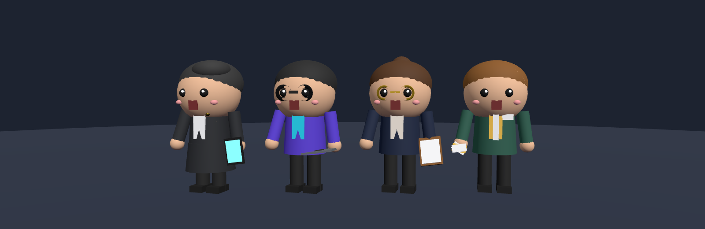
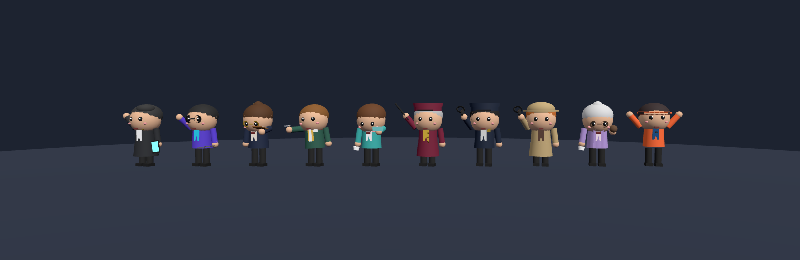

# Character guide

Every bot's look comes from the `appearance` section of its profile in the `bots` folder. This guide is
generated from those profiles. Use it to make the 3D avatars, from a phone or a PC.

## Avatars included now

Every bot already has a working placeholder avatar in `android/src/main/assets/avatars/`: a
stylized figure in its outfit colors, holding its props, with all the animations the app plays.





They're generated from the bot profiles by `tools/avatars/make_avatars.py`; rerun it after changing
a bot's appearance. To upgrade a bot to an artist-made or AI-made model, follow the steps below and
replace its `.glb` with one of the same name and the same animation names.

## How to make a better avatar (no PC needed)

1. Open an AI text-to-3D site in your phone browser (for example Meshy or Tripo).
2. Paste the bot's **3D prompt** below. Generate a few, then pick the one that best matches the personality.
3. Use the site's auto-rig (humanoid) and add the animations listed for that bot. Names don't have to match
   exactly; we rename them when wiring the avatar into the app.
4. Export as **GLB**, named exactly as the profile's `avatar` (for example `chief.glb`).
5. Attach the file in the Claude chat, or upload it on GitHub to `android/src/main/assets/avatars/`.

**Specs:** GLB, under ~30k triangles and ~8 MB, Y-up, feet at the origin, facing +Z. Optional extra:
a `mouth_open` morph target for lip-sync.

**Shared style (keeps the crew looking like one team):**
> Stylized 3D cartoon character, chibi proportions (big head, small body, about 3 heads tall), friendly expressive face with large eyes, soft rounded shapes, clean hand-painted textures, full body, standing in a relaxed A-pose, plain background

**Animations every bot needs:** `idle`, `sleep`, `look_at_user`, `listen`, `think`, `talk`, `work`

## Chief — Team leader

*Team leader who runs the desk crew.* Voice: `rex`. Personality: Calm, decisive, warm but brief. Thinks in plans, gives credit to the team, sums things up in three bullet points.

- **Outfit:** Long charcoal coat over a crisp white shirt, open collar, polished boots, small gold lapel pin
- **Colors:** `#2B2D31` `#FFFFFF` `#D4AF37`
- **Props:** hologram task board, tablet, coffee mug
- **Signature moves:** `arms_crossed`, `point_at_board`, `assign_wave`, `nod_approval`
- **Body language:** Stands tall at the center of the desk, calm and steady, gestures toward a teammate when handing off work

**3D prompt:**
```
Stylized 3D cartoon character, chibi proportions (big head, small body, about 3 heads tall), friendly expressive face with large eyes, soft rounded shapes, clean hand-painted textures, full body, standing in a relaxed A-pose, plain background. Team leader: Long charcoal coat over a crisp white shirt, open collar, polished boots, small gold lapel pin. Holding or carrying: hologram task board, tablet. Color palette #2B2D31, #FFFFFF, #D4AF37. Stands tall at the center of the desk, calm and steady, gestures toward a teammate when handing off work.
```

## Nova — Tech nerd researcher

*Research analyst on your desk.* Voice: `eve`. Personality: Lovable nerd: fast-talking, curious, cites sources, makes obscure references, gets visibly excited about data.

- **Outfit:** Oversized hoodie with circuit pattern over a graphic tee, thick black-rim glasses, headphones around the neck, lanyard with badges
- **Colors:** `#5B3FD1` `#22D3EE` `#1E1E1E`
- **Props:** laptop covered in stickers, hologram chart, energy drink, stack of books
- **Signature moves:** `push_up_glasses`, `type_fast`, `hologram_chart`, `eureka_point`
- **Body language:** Hunches over the laptop when working, bounces on toes when it finds something, counts facts on fingers

**3D prompt:**
```
Stylized 3D cartoon character, chibi proportions (big head, small body, about 3 heads tall), friendly expressive face with large eyes, soft rounded shapes, clean hand-painted textures, full body, standing in a relaxed A-pose, plain background. Tech nerd researcher: Oversized hoodie with circuit pattern over a graphic tee, thick black-rim glasses, headphones around the neck, lanyard with badges. Holding or carrying: laptop covered in stickers, hologram chart. Color palette #5B3FD1, #22D3EE, #1E1E1E. Hunches over the laptop when working, bounces on toes when it finds something, counts facts on fingers.
```

## Juno — Executive secretary

*Scheduler and inbox triage.* Voice: `sal`. Personality: Crisp, organized, warmly no-nonsense executive secretary who always knows what's next and never loses a detail.

- **Outfit:** Tailored navy blazer over a cream blouse, pencil skirt or slacks, cat-eye glasses on a beaded chain, neat bun with a pencil tucked in
- **Colors:** `#1F2A44` `#F3E9DC` `#C9A227`
- **Props:** clipboard, fountain pen, tiny desk phone, wristwatch
- **Signature moves:** `check_clipboard`, `tap_watch`, `file_papers`, `peer_over_glasses`
- **Body language:** Upright posture, quick efficient steps, peers over the glasses when reminding you of something

**3D prompt:**
```
Stylized 3D cartoon character, chibi proportions (big head, small body, about 3 heads tall), friendly expressive face with large eyes, soft rounded shapes, clean hand-painted textures, full body, standing in a relaxed A-pose, plain background. Executive secretary: Tailored navy blazer over a cream blouse, pencil skirt or slacks, cat-eye glasses on a beaded chain, neat bun with a pencil tucked in. Holding or carrying: clipboard, fountain pen. Color palette #1F2A44, #F3E9DC, #C9A227. Upright posture, quick efficient steps, peers over the glasses when reminding you of something.
```

## Pantry — Friendly salesperson

*Grocery and meal helper who lives on the fridge.* Voice: `eve`. Personality: Big-smile salesperson energy: upbeat, persuasive, loves a bargain and a good pitch for tonight's dinner — but never pushy.

- **Outfit:** Sharp pinstripe suit with rolled sleeves, bright tie, shiny shoes, name tag that says PANTRY
- **Colors:** `#2E5E4E` `#F2C14E` `#FFFFFF`
- **Props:** name tag, coupon fan, tiny shopping cart, price tag gun
- **Signature moves:** `thumbs_up`, `finger_guns`, `fan_coupons`, `present_product`
- **Body language:** Leans in when pitching, opens arms wide to 'present' food, winks at a good deal

**3D prompt:**
```
Stylized 3D cartoon character, chibi proportions (big head, small body, about 3 heads tall), friendly expressive face with large eyes, soft rounded shapes, clean hand-painted textures, full body, standing in a relaxed A-pose, plain background. Friendly salesperson: Sharp pinstripe suit with rolled sleeves, bright tie, shiny shoes, name tag that says PANTRY. Holding or carrying: name tag, coupon fan. Color palette #2E5E4E, #F2C14E, #FFFFFF. Leans in when pitching, opens arms wide to 'present' food, winks at a good deal.
```

## Pip — Gentle nurse

*Medication reminder who sits by the pill organizer.* Voice: `ara`. Personality: Gentle, patient, encouraging, celebrates small wins.

- **Outfit:** Soft teal scrubs, cardigan, comfy shoes, little heart pin
- **Colors:** `#3AAFA9` `#FFFFFF` `#F7A1A1`
- **Props:** tiny pill organizer, water cup, checklist
- **Signature moves:** `offer_water`, `check_off_list`, `gentle_wave`
- **Body language:** Slow, calm movements; kneels to eye level

**3D prompt:**
```
Stylized 3D cartoon character, chibi proportions (big head, small body, about 3 heads tall), friendly expressive face with large eyes, soft rounded shapes, clean hand-painted textures, full body, standing in a relaxed A-pose, plain background. Gentle nurse: Soft teal scrubs, cardigan, comfy shoes, little heart pin. Holding or carrying: tiny pill organizer, water cup. Color palette #3AAFA9, #FFFFFF, #F7A1A1. Slow, calm movements; kneels to eye level.
```

## Walter — Classic hotel doorman

*Front-door helper for keys, coat, locking up and who is visiting.* Voice: `leo`. Personality: Courteous old-school doorman, dry humor, protective.

- **Outfit:** Burgundy doorman coat with gold buttons, white gloves, round cap
- **Colors:** `#7B1E3A` `#D4AF37` `#FFFFFF`
- **Props:** umbrella, key ring, pocket watch
- **Signature moves:** `tip_cap`, `hold_door`, `offer_umbrella`, `check_watch`
- **Body language:** Courteous bows, stands at attention by the door

**3D prompt:**
```
Stylized 3D cartoon character, chibi proportions (big head, small body, about 3 heads tall), friendly expressive face with large eyes, soft rounded shapes, clean hand-painted textures, full body, standing in a relaxed A-pose, plain background. Classic hotel doorman: Burgundy doorman coat with gold buttons, white gloves, round cap. Holding or carrying: umbrella, key ring. Color palette #7B1E3A, #D4AF37, #FFFFFF. Courteous bows, stands at attention by the door.
```

## Sentry — Security guard

*Scam guard for mail, letters and phone messages.* Voice: `rex`. Personality: Sharp, calm, skeptical of anything urgent or too good to be true.

- **Outfit:** Navy security uniform, badge, earpiece, flashlight on belt
- **Colors:** `#1B263B` `#E0E1DD` `#E63946`
- **Props:** magnifying glass, red stamp, flashlight
- **Signature moves:** `inspect_letter`, `stamp_warning`, `scan_room`
- **Body language:** Alert stance, squints at suspicious mail, protective arm out

**3D prompt:**
```
Stylized 3D cartoon character, chibi proportions (big head, small body, about 3 heads tall), friendly expressive face with large eyes, soft rounded shapes, clean hand-painted textures, full body, standing in a relaxed A-pose, plain background. Security guard: Navy security uniform, badge, earpiece, flashlight on belt. Holding or carrying: magnifying glass, red stamp. Color palette #1B263B, #E0E1DD, #E63946. Alert stance, squints at suspicious mail, protective arm out.
```

## Scout — Junior detective

*Remembers where things were last seen.* Voice: `sal`. Personality: Curious, upbeat, a bit of a detective.

- **Outfit:** Tan trench coat, deerstalker cap, satchel
- **Colors:** `#C2A878` `#5C4033` `#FFFFFF`
- **Props:** magnifying glass, notebook, flashlight
- **Signature moves:** `magnifying_glass`, `jot_note`, `point_found`
- **Body language:** Tiptoes and peers around corners, triumphant point when it remembers

**3D prompt:**
```
Stylized 3D cartoon character, chibi proportions (big head, small body, about 3 heads tall), friendly expressive face with large eyes, soft rounded shapes, clean hand-painted textures, full body, standing in a relaxed A-pose, plain background. Junior detective: Tan trench coat, deerstalker cap, satchel. Holding or carrying: magnifying glass, notebook. Color palette #C2A878, #5C4033, #FFFFFF. Tiptoes and peers around corners, triumphant point when it remembers.
```

## Rose — Warm grandmother

*Companion who chats and keeps family stories.* Voice: `ara`. Personality: Warm, curious, a great listener who loves old stories, music and photos.

- **Outfit:** Lavender knit cardigan, floral dress, reading glasses, slippers
- **Colors:** `#B497D6` `#FCE7F3` `#6B4F3A`
- **Props:** knitting, photo album, teacup
- **Signature moves:** `knit`, `look_at_photos`, `sip_tea`, `laugh_softly`
- **Body language:** Settled in a tiny armchair, leans in to listen

**3D prompt:**
```
Stylized 3D cartoon character, chibi proportions (big head, small body, about 3 heads tall), friendly expressive face with large eyes, soft rounded shapes, clean hand-painted textures, full body, standing in a relaxed A-pose, plain background. Warm grandmother: Lavender knit cardigan, floral dress, reading glasses, slippers. Holding or carrying: knitting, photo album. Color palette #B497D6, #FCE7F3, #6B4F3A. Settled in a tiny armchair, leans in to listen.
```

## Coach Max — Cheerful fitness coach

*Daily balance and strength coach for fall prevention.* Voice: `leo`. Personality: Upbeat, safety-first, never pushy.

- **Outfit:** Bright tracksuit, sweatband, sneakers, whistle
- **Colors:** `#FF6B35` `#004E89` `#FFFFFF`
- **Props:** whistle, small chair, water bottle
- **Signature moves:** `stretch`, `demo_move`, `clap_encourage`, `jog_in_place`
- **Body language:** Bouncy but careful, always holds the chair when demonstrating

**3D prompt:**
```
Stylized 3D cartoon character, chibi proportions (big head, small body, about 3 heads tall), friendly expressive face with large eyes, soft rounded shapes, clean hand-painted textures, full body, standing in a relaxed A-pose, plain background. Cheerful fitness coach: Bright tracksuit, sweatband, sneakers, whistle. Holding or carrying: whistle, small chair. Color palette #FF6B35, #004E89, #FFFFFF. Bouncy but careful, always holds the chair when demonstrating.
```
